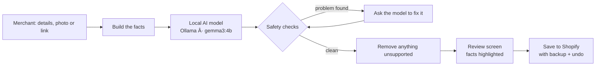

<div align="center">

# Store AI Writer

### Facts in. Good copy out.

An AI product-text writer for online stores. Give it a product's details or a photo, and it writes the title, description, SEO text and tags, **without inventing a single detail**.


</div>

---

## Why this exists

Most AI writers are fluent and careless. Give one a plain steel kadai and it adds "premium quality, perfect for the whole family". That is a claim the shop owner never made and can't stand behind.

Store AI Writer is built around one rule: **the text may only use facts the merchant gave us.** Everything else is removed before the merchant ever sees it.

The long-term goal is a product many shop owners can use: connect any store, pick the products that need text, review what the AI wrote, and publish with one click and an undo.

## What it does

| | |
|---|---|
| **Products** | Lists a store's products with photos, shows which ones have no description, writes text for the ones you pick, and lets you review, edit and save. |
| **Quick write** | Describe a product in plain words, add a photo, or paste a product page link. Get a description, plus optional title, search title, search summary and tags. |
| **Settings** | Set tone, language, length, paragraphs and brand voice once. Every product starts with those defaults. |
| **Photo reading** | A vision model describes what's visible, such as colour and pattern, and adds it to the facts. |
| **Link reader** | Paste a product page link and the name, details and photo are filled in for you to check. |
| **Safety net** | Invented numbers, quality claims, made-up sentences and made-up tags are caught, retried, and finally removed. |
| **Undo** | Every save to a store keeps a backup first, so any change can be reversed. |

## How it works



**The safety net, in detail**

1. The model must answer in structured JSON, which is parsed and checked for length and paragraph count.
2. Every number in the text (sizes, quantities, capacity) must appear in the merchant's facts.
3. Per-category lists of risky words, like "premium", "high quality" or "perfect for kids", are flagged unless the merchant said them.
4. Filler such as "no tags provided" is caught.
5. If something is wrong, the model gets one chance to fix it.
6. As a last step, sentences and tags that are mostly new words are removed, and the merchant is told exactly what was removed.

## Quick start (Windows)

You need **Python 3.10+** (tick "Add Python to PATH") and **[Ollama](https://ollama.com)** running.

```powershell
cd backend
.\setup.bat      # creates the environment, installs packages, downloads gemma3:4b, tests it
.\run.bat        # starts the app
```

Then open **http://127.0.0.1:8000/**. It opens on the Products page with a sample store, so nothing real is touched.

<details>
<summary><b>Manual setup (Windows, Mac, Linux)</b></summary>

Run every command inside the `backend` folder.

```powershell
cd backend
python -m venv .venv
.venv\Scripts\activate            # Mac/Linux: source .venv/bin/activate
pip install -r requirements.txt
ollama pull gemma3:4b
python check_model.py             # prints the model name and a test sentence
python -m pytest -q               # all tests should pass; no model needed
uvicorn app.main:app --reload     # keep this terminal open
```

Never `pip install app`. `app` is this project's own folder.

</details>

## Connect a real Shopify store

For development, the app can connect to one store using settings in `backend/.env`. Never commit this file; it is already ignored.

```powershell
cd backend
powershell -ExecutionPolicy Bypass -File .\connect-shopify.ps1
```

The script asks for the store name and the key (typed hidden), saves them, and checks the connection. No restart is needed, and `-Disconnect` returns to the sample store. The app needs the `read_products` and `write_products` permissions.

> The merchant-facing "Connect with Shopify" button is built but not switched on yet. It will use Shopify's install flow (OAuth), so shop owners never touch keys. See the roadmap.

## Configuration

Copy `backend/.env.example` to `backend/.env`.

| Setting | What it does |
|---|---|
| `OLLAMA_MODEL` | Writing model. Default `gemma3:4b`. |
| `OLLAMA_VISION_MODEL` | Model that reads photos. Empty means use `OLLAMA_MODEL`. |
| `OLLAMA_BASE_URL` | Where Ollama is running. |
| `PROVIDER_ORDER` | For example `nvidia,ollama` to try a hosted model first. Needs an NVIDIA key (see `.env.example`). |
| `SHOPIFY_SHOP` | Store name, the part before `.myshopify.com`. |
| `SHOPIFY_ACCESS_TOKEN` | Admin API token, or use the two settings below. |
| `SHOPIFY_CLIENT_ID` / `SHOPIFY_CLIENT_SECRET` | For a Dev Dashboard app. |

Shopify settings are read on every request, so changing them needs no restart. The others are read at startup.

## API

Interactive docs live at `/docs`.

| Endpoint | Purpose |
|---|---|
| `POST /generate` | Write text from structured product data. |
| `POST /quick/generate` | Write text from plain words, an optional photo and options. |
| `POST /quick/link` | Read a product page link and return its name, details and photo. |
| `GET /shopify/status` | Sample or live mode, and which store. |
| `GET /shopify/check` | Try a small read to confirm the connection works. |
| `GET /shopify/products` | List products, with search. |
| `POST /shopify/save` | Save approved text, keeping a backup first. |
| `POST /shopify/undo` | Restore the backup. |

<details>
<summary><b>Example: Quick write request</b></summary>

```json
{
  "description": "Insulated stainless steel water bottle, 750 ml, keeps drinks cold 24 hours, leak-proof lid, 5 colors",
  "keywords": "gym bottle",
  "options": { "tone": "friendly", "paragraphs": 1, "detail": "concise", "language": "English" },
  "fields": ["description", "tags", "seo_title"]
}
```

</details>

<details>
<summary><b>Example: structured product request</b></summary>

```json
{
  "product": { "title": "Women Red Maxi Dress", "product_type": "Dress",
               "attributes": { "color": "red", "length": "full length" } },
  "options": { "category": "auto", "tone": "professional", "paragraphs": 2, "detail": "detailed" },
  "fields": ["title", "description", "seo_title", "seo_description", "tags"]
}
```

</details>

## Project layout

```
store-ai-writer/
├── backend/
│   ├── app/
│   │   ├── main.py          routes, UI, app setup
│   │   ├── quick.py         Quick write and link endpoints
│   │   ├── shopify.py       store connection, products, save, undo, check
│   │   ├── service.py       generate → check → retry loop
│   │   ├── prompts.py       the instructions given to the model
│   │   ├── validators.py    JSON, length, invented-detail and invented-number checks
│   │   ├── categories.py    per-store-type rules and risky words (add new store types here)
│   │   ├── llm.py           providers, rate limit, failover
│   │   ├── vision.py        reads product photos
│   │   ├── linkreader.py    reads product page links, with safety guards
│   │   ├── schemas.py       request and response formats
│   │   └── config.py        settings
│   ├── static/index.html    the whole interface in one file
│   ├── tests/               automated tests
│   ├── compare_models.py    compare models side by side
│   ├── connect-shopify.ps1  connect or disconnect a store
│   ├── setup.bat · run.bat · setup.sh
│   └── .env.example
├── pytest.ini
└── pyrightconfig.json
```

## Why gemma3:4b

Before choosing a default, two small models were compared on the same five products (`compare_models.py`).

| | qwen2.5:3b | gemma3:4b |
|---|---|---|
| Average time per product | 16.8 s | 11.6 s |
| Products with warnings | 4 of 5 | 0 of 5 |
| Invented content | Plots, "variety of shapes and sizes", a repeated-word glitch | None |
| Empty tags | Toy and book | None |

Five products is a strong signal, not proof, so the comparison script is kept for re-testing on real store data.

## Tips for a 4 GB GPU

- Close heavy apps and browser tabs while writing.
- If it's too slow or runs out of memory, set `OLLAMA_MODEL=qwen2.5:1.5b` and run `ollama pull qwen2.5:1.5b`.
- Try other models by changing `OLLAMA_MODEL`, for example `llama3.2:3b`.
- Expect about 10 to 20 seconds per product. The first request is slower while the model loads.

## Security notes

- `.env` and `backend/data/` (saved backups) are git-ignored. Never commit keys.
- The link reader only fetches public `http(s)` addresses and re-checks every redirect, so a pasted link can't reach this computer or a private network.
- Nothing is saved to a store until the merchant approves it.

## Known limits

- The local model handles one request at a time, which is fine for development but not for many shops at once.
- Some marketplaces, such as Flipkart, block automated page reads, so link reading is best effort. Shopify product pages work well.
- The safety net is deliberately strict. It can remove a sentence that restates a given fact in new words. This is the main setting to tune against real merchant data.
- Settings are saved in the browser, not in an account.

## Roadmap

- [x] Writing engine with safety checks and retries
- [x] Sample store, review screen, save and undo
- [x] Quick write with photo and link reading
- [x] Settings and merchant-friendly connect screen
- [ ] Shopify install flow (OAuth) as a public app
- [ ] Accounts, with each merchant's store token saved in a database
- [ ] Hosted model so many shops can write at once
- [ ] Several stores per account
- [ ] Usage limits and billing

## Contributing

1. Create a branch for your change.
2. Run `python -m pytest -q` inside `backend` and make sure everything passes.
3. Never commit `.env`, tokens or `backend/data/`.
4. Open a pull request with a short description of what changed and why.

New store types (for example pet supplies or furniture) are added in `app/categories.py`, with their keywords and risky words, plus a test.
